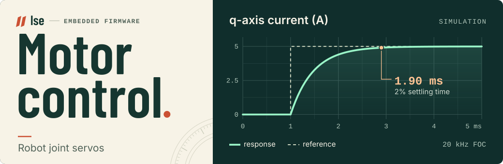

<picture>
  <source media="(max-width: 640px)" srcset="https://raw.githubusercontent.com/lse872317312010/lse872317312010/main/assets/current-loop-mobile.svg">
  
</picture>

我是 **lse**，在 STM32 和 TI C2000 上写电机控制固件，主要关注机器人关节。调电流环时，我喜欢把编码器采样、ADC 触发和 PWM 更新画在同一条时间轴上，看一拍延迟会怎样改变电流响应。

### 电机实验台

[**Open Engineering Agent Lab**](https://github.com/lse872317312010/open-engineering-agent-lab) 是我用 Python 验证电机模型和控制算法的地方。封面取自其中一个 PMSM 仿真。q 轴电流给定从 0 跳到 5 A 后，仿真电流用 **1.90 ms** 进入并保持在目标值的 ±2% 以内。

[阶跃工况](https://github.com/lse872317312010/open-engineering-agent-lab/blob/6de92cd05bbc10392afbbc2e94330b66ee827441/examples/foc_step.json) · [电流 PI 源码](https://github.com/lse872317312010/open-engineering-agent-lab/blob/6de92cd05bbc10392afbbc2e94330b66ee827441/src/oeal/current_control.py) · [从绕组铜耗到定子温升](https://github.com/lse872317312010/open-engineering-agent-lab/blob/main/docs/p7-stator-thermal.md)

### 其他开源项目

- [**Personal OS**](https://github.com/lse872317312010/personal-os)　把目标、行动和复盘记录保存在本地，换一个 AI Agent 也能接着上次的计划走。
- [**Android Pocket NAS**](https://github.com/lse872317312010/android-pocket-nas)　尝试把闲置手机变成家庭网盘，在外面用另一台手机按需取文件。
- [**QuantOs**](https://github.com/lse872317312010/QuantOs)　把市场判断和当时能看到的证据放在一起，方便事后检验自己的假设。

### 集卡大全

  
<strong>📁 Panel</strong>

  

    
    
    
  

  语言占比按公开仓库的代码量统计，提交时段按北京时间（UTC+8）汇总。

